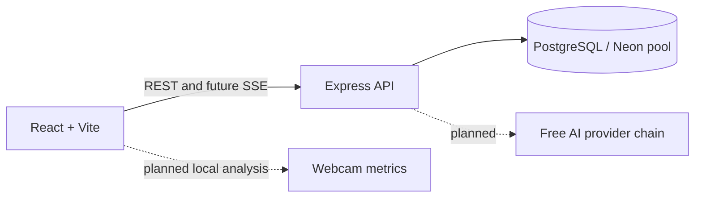
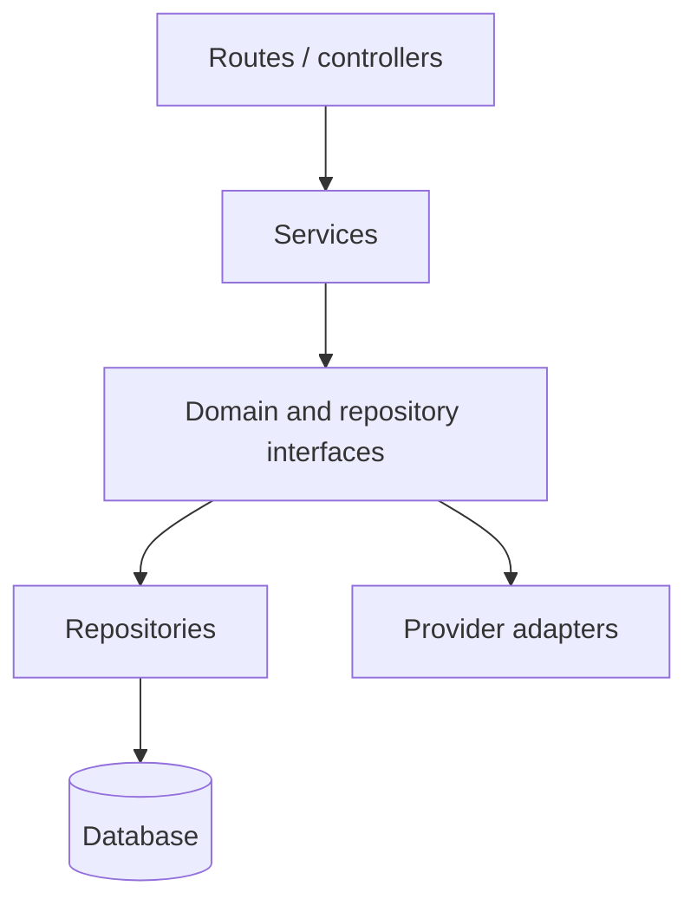
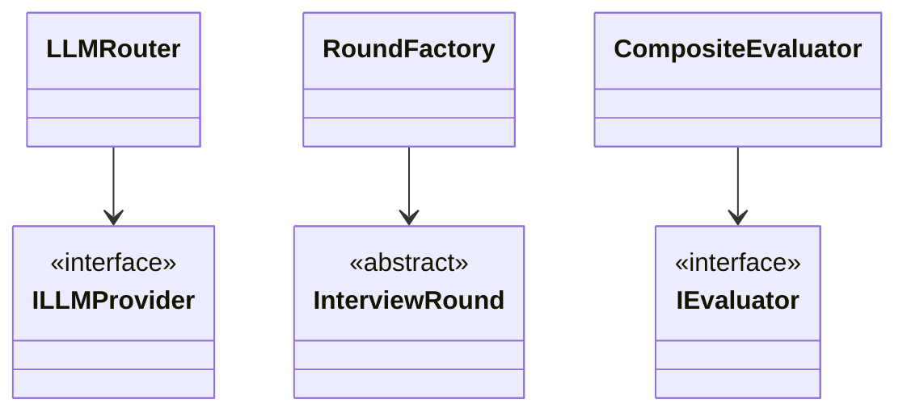
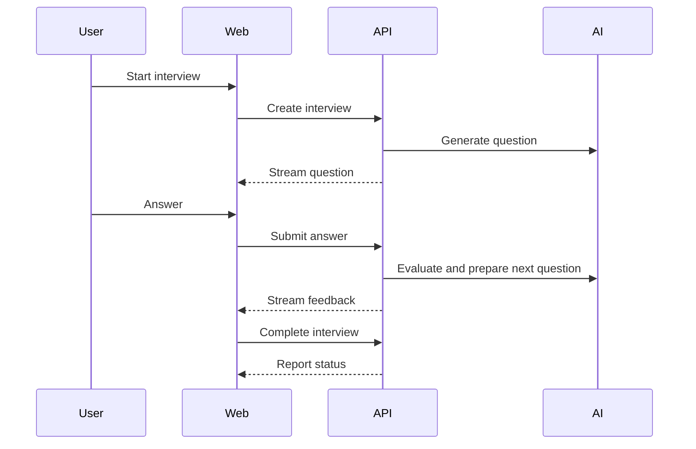

# Architecture

Currently implemented: frontend scaffold, HTTP foundation, DI composition root, event bus and database schema/client. The interview sequence and domain components below are targets, not implemented features.

## System

## Layers

Only the application foundation and DB client exist today; repositories, services and providers are planned.

## Planned class diagram

## Planned interview sequence

The in-process event bus exists, but report generation and a durable job queue do not yet exist. Async work must account for process restarts before deployment.
