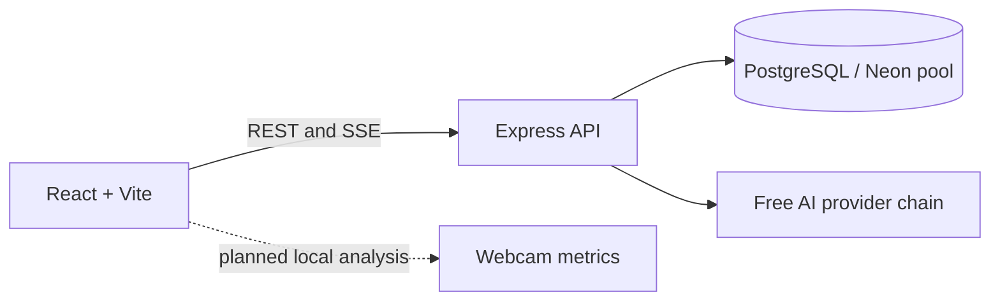
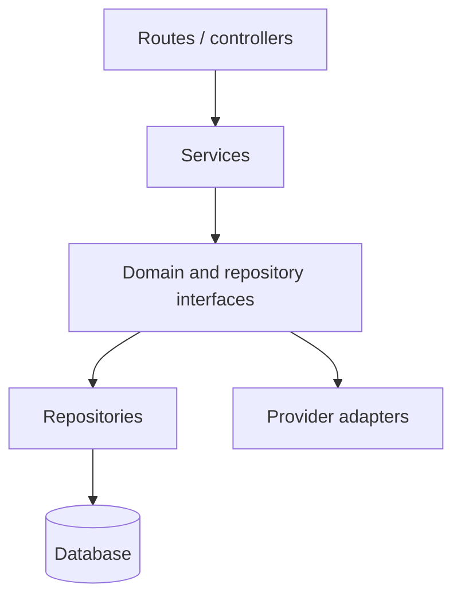
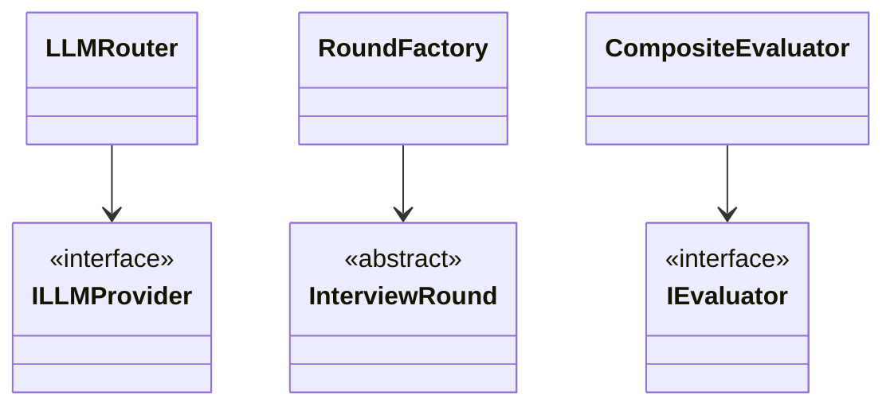
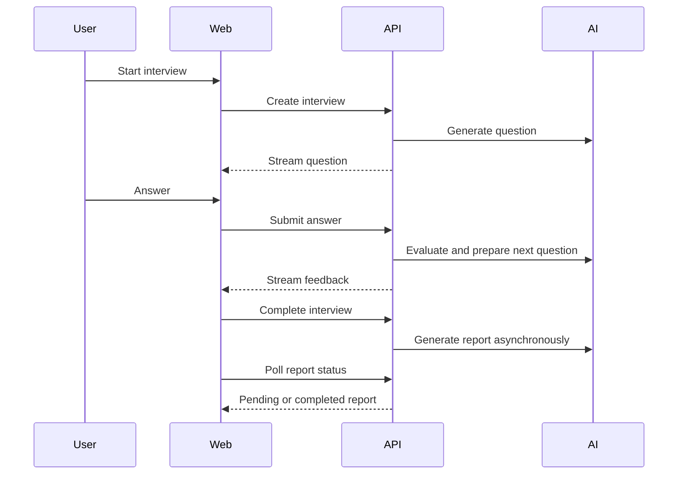

# Architecture

Currently implemented: responsive React frontend, HTTP foundation, auth and user repository, AI provider chain, round and evaluator strategies, interview API and repository, asynchronous report generation, analytics, DI composition root, event bus and database schema/client.

## System

## Layers

The auth service and user repository now implement this layering. The interview service depends on repository and evaluator interfaces; its PostgreSQL repository locks the parent interview for state changes. The user reported a successful live Groq interview smoke test; the other providers and live report generation are not yet verified.

## Class diagram

## Interview sequence

The in-process event bus starts report generation. The status map is not a durable job queue; requesting a completed interview’s missing report can schedule it again after restart. Multiple instances can duplicate AI work, although the database unique constraint prevents duplicate reports.

## Authentication

Routes validate input and call `AuthService`, which depends on `IUserRepository`. `DrizzleUserRepository` is injected by the container; tests inject an in-memory implementation. Passwords use bcrypt, and one-hour JWTs are stored in httpOnly cookies. Logout clears the browser cookie but does not revoke copied tokens.

## AI routing

`LLMRouter` tries registered providers in configured order, twice each, with timeouts and independent circuit breakers. It records metadata through a repository interface. `JsonGenerator` validates outputs and requests one repair. Cached completions are opt-in and scoped; live streams are not cached. AI vendor keys are server-side only. Interview routes invoke this AI layer.

## Interview flow

`InterviewService` validates ownership through `IInterviewRepository`. Each answer is evaluated while a possible next question is prepared; the best-effort candidate is scoped to the user and kept in a bounded process-local cache for 60 seconds. Feedback is not delayed waiting for prefetch. The cache may miss after restart or across instances, and prefetch does not yet start while the user is still speaking. SSE deltas are provisional raw model text; only validated completion events are persisted. The event bus is not a durable queue.

## Reports and analytics

An `interview.completed` event schedules `ReportService`. It validates AI-generated strengths, weaknesses, tips and summary, and computes the 0–10 overall score as the rounded mean of answer scores. Status is process-local; a failed job can be retried and a missing report is scheduled on access. Only the latest ten truncated turns are sent to the report prompt to limit tokens, while the score uses all answers. `IReportRepository` and `IAnalyticsRepository` isolate database access. Live report generation is not yet manually verified.

## Frontend

React Router provides public and protected routes. TanStack Query owns server state, Zustand stores the current answer draft, and a fetch-based SSE parser handles both GET and POST streams. SSE deltas are provisional and the final validated event is authoritative. Dashboard charts use Recharts and are loaded with the dashboard route. The development Vite proxy forwards `/api` to Express; production can configure `VITE_API_URL` (the API base including `/api`) but cross-site cookie support depends on browser and deployment settings.

## Speech

The browser can read questions with speech synthesis and use Web Speech recognition after an explicit click. Some browser recognition implementations transmit audio to their own provider. A separate opt-in MediaRecorder path sends audio to an authenticated, owner-checked, rate-limited API and the server-only `ITranscriber` Groq adapter; it does not write audio to disk. Browser-derived speech metrics are approximate; no metrics are submitted after editing a transcript or appending to existing text. Live microphone and provider behavior remain unverified.

## PDF report export (Phase 7 in progress)

An injected report PDF renderer creates an in-memory PDF after checking ownership and report readiness. The download route does not start a report job. Built-in PDF fonts currently have limited Unicode coverage; resume extraction and analysis are still in progress.
