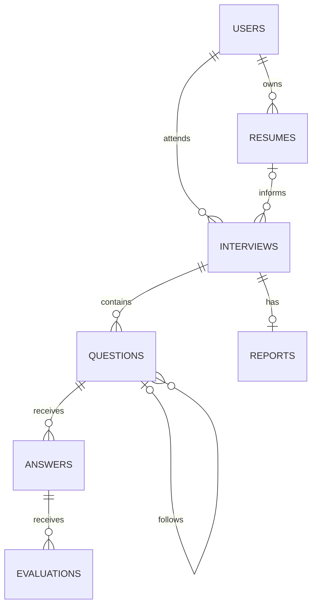

# Database

Drizzle schema and versioned migrations cover users, interviews, related reports, resumes, camera aggregates and mock tests. The user reported completing migration instructions through 0006 locally; this sandbox cannot independently verify Neon. Candidate question feedback has its own table.

- `users`: account and profile; skills stored as JSON.
- `resumes`: extracted text, skills and approximate last AI match score (stored in `ats_score` for schema compatibility), belonging to a user; the original file and full analysis are not stored. Deletion clears interview references but does not remove already-generated interview content.
- `interviews`: user, role, optional resume, type, difficulty and status.
- `questions`: interview question and optional parent follow-up.
- `answers`: text and optional speech metrics.
- `evaluations`: answer scores and feedback.
- `reports`: one final summary per interview.
- `ai_usage_logs`: provider attempt performance and token usage; the AI router writes metadata via its repository when a database is configured. Logging is best effort and no prompt or generated text is stored there.

Indexes support interview history, ordered questions and answer lookup. Foreign keys use cascade deletion for owned records and set nullable links to null when appropriate. This initial schema does not yet enforce all business rules or score bounds; implement validation and ownership checks with the corresponding services.

## Authentication access

The user repository is the only authentication component that queries the `users` table. Emails are normalized to lowercase on registration and login; the database unique constraint protects against concurrent duplicate registration. No schema change was needed in Phase 1.

## Interview domain status

Migration 0002 adds the interview role and unique indexes on question order, answer per question and evaluation per answer. Transactions lock the interview row before state transitions, and answers plus evaluations are written together. The user reported the migration succeeded on Neon; repository behavior was additionally exercised on isolated PGlite. Back up existing data before migrating; existing duplicate rows would need resolution before unique indexes can be created.

## Reports and analytics

Phase 4 uses the existing `reports` table and its unique `interview_id` index; it adds no schema migration. Report insertion is idempotent across concurrent generators. Analytics queries join reports to user-owned completed interviews. Failed/pending job status is in memory, not persisted; a missing report can be scheduled again after restart.

## Voice

Phase 6 adds no migration. Existing answer speech metrics and evaluation data are stored when supplied; audio recordings are not stored by the application. Text transcriptions enter the editable answer field and are saved only when the answer is submitted.

Phase 7 uses the existing resume table and foreign key; it adds no migration. Resume text persists until the owner deletes it or the user is deleted.

## Camera observations (Phase 8 in progress)

Migration `0003_tricky_lorna_dane.sql` adds `camera_observations`, keyed to one interview with cascading deletion. It stores only explicitly shared bounded counters and an update time; no video, frames, or landmarks. Users can delete the observations separately. Migration `0004_violet_the_leader.sql` adds pose, wrist and hand-height aggregate counters, defaulting existing rows to zero. Apply migrations through 0004 to Neon before saving or retrieving camera data.

## Mock tests

Migration `0005_green_chimera.sql` adds owner-scoped `mock_tests`: topic, a question/answer-key snapshot, final selected answers, score, and timestamps. A conditional update permits completion only once. Attempts cascade on user deletion and may be deleted individually. Draft selections are not persisted. Migration 0005 was tested with PGlite; the user subsequently reported completing migration instructions through 0006.

## Question feedback

Migration `0006_peaceful_shinobi_shaw.sql` adds one `question_feedback` record per interview question, with a 1–5 rating, optional comment (up to 1,000 characters) and update time. It cascades when its question is deleted. The API checks the interview owner and the question/interview relationship. Feedback is independent of answer evaluations and is not used for scoring or AI prompts. The user reported completing migration instructions through 0006; Neon has not been independently verified.

## Account deletion

After password reauthentication, deleting a user cascades through their owned resumes, interviews, questions, answers, evaluations, reports, camera observations, question feedback and mock tests. AI usage metadata is not tied to an account and is retained. Database backups, operational logs, previously downloaded files and copies held by AI or transcription providers are not deleted by this operation.

## Session revocation

Migration `0007_romantic_echo.sql` adds a non-null `users.session_version` counter. A conditional atomic increment on logout revokes all sessions from that generation, and protected requests compare their JWT generation to the database. Apply this migration before starting the new API; existing JWTs without a generation will no longer authenticate and users must sign in again. A login concurrent with logout can receive an already-revoked token and may need to be retried. Already authenticated in-flight requests may still finish. PGlite tests do not establish Neon deployment status.
