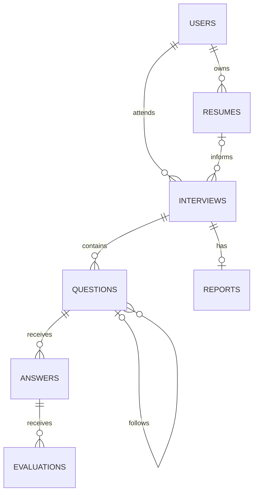

# Database

Drizzle schema and versioned migrations currently cover the initial eight tables. The user indicated that earlier migrations were run locally; migration 0002 was tested with PGlite and the user reported a successful Neon migration. Mock tests, candidate feedback and webcam metrics are planned for later migrations.

- `users`: account and profile; skills stored as JSON.
- `resumes`: extracted text, skills and ATS score, belonging to a user.
- `interviews`: user, role, optional resume, type, difficulty and status.
- `questions`: interview question and optional parent follow-up.
- `answers`: text and optional speech metrics.
- `evaluations`: answer scores and feedback.
- `reports`: one final summary per interview.
- `ai_usage_logs`: provider attempt performance and token usage; the AI router writes metadata via its repository when a database is configured. Logging is best effort and no prompt or generated text is stored there.

Indexes support interview history, ordered questions and answer lookup. Foreign keys use cascade deletion for owned records and set nullable links to null when appropriate. This initial schema does not yet enforce all business rules or score bounds; implement validation and ownership checks with the corresponding services.

## Authentication access

The user repository is the only authentication component that queries the `users` table. Emails are normalized to lowercase on registration and login; the database unique constraint protects against concurrent duplicate registration. No schema change was needed in Phase 1.

## Interview domain status

Migration 0002 adds the interview role and unique indexes on question order, answer per question and evaluation per answer. Transactions lock the interview row before state transitions, and answers plus evaluations are written together. The user reported the migration succeeded on Neon; repository behavior was additionally exercised on isolated PGlite. Back up existing data before migrating; existing duplicate rows would need resolution before unique indexes can be created.
