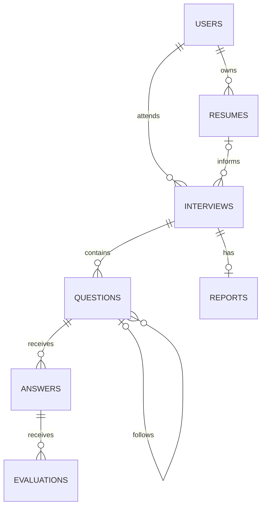

# Database

Drizzle schema and versioned migrations currently cover the initial eight tables. The user indicated that migrations were run locally; the sandbox could not independently verify Neon. Mock tests, candidate feedback and webcam metrics are planned for later migrations.

- `users`: account and profile; skills stored as JSON.
- `resumes`: extracted text, skills and ATS score, belonging to a user.
- `interviews`: user, optional resume, type, difficulty and status.
- `questions`: interview question and optional parent follow-up.
- `answers`: text and optional speech metrics.
- `evaluations`: answer scores and feedback.
- `reports`: one final summary per interview.
- `ai_usage_logs`: provider performance and token usage; not yet written by the app.

Indexes support interview history, ordered questions and answer lookup. Foreign keys use cascade deletion for owned records and set nullable links to null when appropriate. This initial schema does not yet enforce all business rules or score bounds; implement validation and ownership checks with the corresponding services.

## Authentication access

The user repository is the only authentication component that queries the `users` table. Emails are normalized to lowercase on registration and login; the database unique constraint protects against concurrent duplicate registration. No schema change was needed in Phase 1.
